# Arquitectura del modelo final

Este documento describe la CNN propia utilizada en
**`experimento-7-wd001-folds`** y cómo sus cinco redes forman el predictor
final. Se entrenó desde cero, sin redes de catálogo ni pesos preentrenados,
para predecir pCR a partir de resonancia mamaria anterior al tratamiento.

La descripción se ha contrastado con el `config.json` congelado de
`runs/experimento-7-wd001-folds/20261025T114348_995603Z/`, el constructor
[`model.py`](../src/breastdcedl/model.py) y el manifiesto
[`experiments/modelo_final.json`](../experiments/modelo_final.json).
La configuración del manifiesto coincide con la del run. La plantilla de
`configs/config.json` no define la arquitectura descrita aquí.

## Una arquitectura, cinco redes entrenadas

Cada red contiene **seis convoluciones en cuatro bloques**, un promedio global
(GAP) y una cabeza de clasificación con una capa oculta de 64 unidades.
Tiene **117.329 parámetros entrenables**.

El predictor final conserva una red por fold, con la misma arquitectura pero
pesos y estadísticas de normalización propios. Combina sus probabilidades con
igual peso, sin entrenar una sexta red sobre todo desarrollo. Las cinco redes
almacenan **586.645 parámetros**; el promedio no añade parámetros.

## Diagrama de la arquitectura y de la predicción

Los tamaños corresponden a **un corte de 256 × 256 píxeles**, sin el eje de lote.
La parte central muestra una de las cinco redes. El predictor repite ese
recorrido con los pesos y la normalización de cada fold.

```mermaid
flowchart TD
    entrada["Un corte: PRE · EARLY · LATE<br/>3 × 256 × 256 · PNG gris de 8 bits"]
    escala["Conversión a float32 y división entre 255<br/>Valores entre 0 y 1"]
    norm["Para cada red k: estandarización propia<br/>(x − media train k) / desviación train k"]
    entrada --> escala --> norm

    subgraph red["CNN del fold k · 117.329 parámetros"]
        b1["Bloque 1<br/>Conv 3→16 + ReLU · Conv 16→16 + ReLU<br/>MaxPool 2×2<br/>Salida: 16 × 128 × 128"]
        b2["Bloque 2<br/>Conv 16→32 + ReLU · Conv 32→32 + ReLU<br/>MaxPool 2×2<br/>Salida: 32 × 64 × 64"]
        b3["Bloque 3<br/>Conv 32→64 + ReLU<br/>MaxPool 2×2<br/>Salida: 64 × 32 × 32"]
        b4["Bloque 4<br/>Conv 64→128 + ReLU<br/>MaxPool 2×2<br/>Salida: 128 × 16 × 16"]
        gap["Promedio global adaptativo: GAP<br/>128 × 1 × 1 → vector de 128"]
        densa["Densa 128→64 + ReLU<br/>Vector de 64"]
        drop["Dropout p = 0,2<br/>Activo solo durante entrenamiento"]
        salida["Densa 64→1<br/>Un logit z"]
        b1 --> b2 --> b3 --> b4 --> gap --> densa --> drop --> salida
    end

    norm --> b1
    salida --> sigmoid["Sigmoid del logit<br/>Probabilidad p_k del corte"]
    sigmoid --> conjunto["Media de p_0, p_1, p_2, p_3 y p_4<br/>Probabilidad del corte del conjunto de cinco redes"]
    conjunto --> paciente["Si hay varios cortes de la misma paciente:<br/>media de sus probabilidades, igual peso por corte"]
    paciente --> decision["Umbral final: 0,35<br/>p ≥ 0,35: pCR · p &lt; 0,35: no-pCR"]

    classDef entradaStyle fill:#e8f1fb,stroke:#35689a,color:#172b40
    classDef bloqueStyle fill:#edf5ee,stroke:#4b7955,color:#203c25
    classDef cabezaStyle fill:#fff4df,stroke:#a87a2b,color:#4c3815
    classDef resultadoStyle fill:#eeeafa,stroke:#75609b,color:#35274c
    class entrada,escala,norm entradaStyle
    class b1,b2,b3,b4 bloqueStyle
    class gap,densa,drop,salida cabezaStyle
    class sigmoid,conjunto,paciente,decision resultadoStyle
```

Todas las convoluciones son **3 × 3**, con stride 1, padding 1 y sesgo.
Cada convolución va seguida de ReLU. Todos los MaxPool son **2 × 2**, con
stride 2, sin padding y sin redondeo hacia arriba. No hay BatchNorm, GroupNorm,
atención, conexiones residuales ni variables clínicas en esta arquitectura.

## Entrada y normalización

Los canales son las fases temporales **PRE, EARLY y LATE**, en ese orden.
No representan colores RGB. Cada triplete debe corresponder a la misma
paciente y al mismo corte, con fases alineadas y de idénticas dimensiones.
La entrada por lotes tiene forma `N × 3 × H × W`.

Primero se convierten los píxeles a `float32` y se dividen entre 255. Después,
cada red aplica la media y desviación estándar guardadas con su checkpoint:

`x_normalizado = (x / 255 − media_train) / desviación_train`

La división entre 255 se realiza una sola vez. La media y la desviación son
escalares comunes a las tres fases, calculados solo con los píxeles de train
del fold, incluido el fondo. No se ajustan con validación, test ni imágenes
nuevas. Cada una de las cinco redes utiliza sus propias estadísticas.

Esta estandarización de entrada es distinta de BatchNorm: no añade una capa
entre convoluciones ni estadísticas actualizadas durante la inferencia.

## Recorrido capa por capa

Las formas son `canales × alto × ancho`, salvo los vectores de la cabeza.
Los recuentos incluyen pesos y sesgos. ReLU, pooling, aplanado y dropout no
tienen parámetros entrenables.

| Etapa | Operación | Salida para un corte | Parámetros |
|---|---|---|---:|
| Entrada | PRE/EARLY/LATE normalizados | 3 × 256 × 256 | 0 |
| Bloque 1 | Conv 3→16, 3×3 + ReLU | 16 × 256 × 256 | 448 |
| Bloque 1 | Conv 16→16, 3×3 + ReLU | 16 × 256 × 256 | 2.320 |
| Bloque 1 | MaxPool 2×2 | 16 × 128 × 128 | 0 |
| Bloque 2 | Conv 16→32, 3×3 + ReLU | 32 × 128 × 128 | 4.640 |
| Bloque 2 | Conv 32→32, 3×3 + ReLU | 32 × 128 × 128 | 9.248 |
| Bloque 2 | MaxPool 2×2 | 32 × 64 × 64 | 0 |
| Bloque 3 | Conv 32→64, 3×3 + ReLU | 64 × 64 × 64 | 18.496 |
| Bloque 3 | MaxPool 2×2 | 64 × 32 × 32 | 0 |
| Bloque 4 | Conv 64→128, 3×3 + ReLU | 128 × 32 × 32 | 73.856 |
| Bloque 4 | MaxPool 2×2 | 128 × 16 × 16 | 0 |
| GAP | AdaptiveAvgPool2d(1) | 128 × 1 × 1 | 0 |
| Aplanado | Retirar los ejes espaciales 1×1 | 128 | 0 |
| Cabeza | Linear 128→64 + ReLU | 64 | 8.256 |
| Cabeza | Dropout, p = 0,2 | 64 | 0 |
| Salida | Linear 64→1 | 1 logit | 65 |
| **Total por red** | | | **117.329** |

Para una convolución, los parámetros son
`C_salida × (C_entrada × 3 × 3 + 1)`; el término adicional es el sesgo.
Para una capa densa son `salidas × (entradas + 1)`.

### Qué hace cada componente

**Convoluciones y ReLU.** Las convoluciones aprenden filtros locales a partir
de los datos. La primera ya combina las tres fases temporales; no hay tres
ramas independientes. El padding conserva altura y anchura dentro del bloque.
ReLU introduce una transformación no lineal mediante `max(0, x)`.
No se asigna a los filtros un significado clínico conocido.

**Bloques y MaxPool.** Los dos primeros bloques contienen dos convoluciones
cada uno; los dos siguientes, una. El pooling reduce a la mitad cada dimensión
espacial, mientras los bloques aumentan los canales de 16 a 32, 64 y 128.
Esto reduce el coste de capas posteriores y permite combinar características
sobre regiones progresivamente mayores, a cambio de perder detalle espacial.

**Promedio global (GAP).** Cada uno de los 128 mapas finales se resume mediante
su media espacial. Para la entrada de entrenamiento, transforma 128 mapas de
16 × 16 en 128 valores. La densa recibe 128 características en lugar de las
32.768 que produciría aplanar directamente esos mapas. Esto reduce parámetros
y mantiene fija la entrada de la cabeza aunque cambien H y W. El promedio
pierde información sobre la posición exacta de las activaciones.

**Cabeza densa y dropout.** La capa 128→64 combina las características globales
y aplica ReLU. Después, dropout anula aleatoriamente el 20 % de las activaciones
durante entrenamiento y reescala las restantes. En evaluación está desactivado:
no se eliminan activaciones aleatoriamente ni se realiza Monte Carlo dropout.
La capa 64→1 produce el logit final.

**Logit y probabilidad.** La CNN devuelve un número real sin acotar, el logit
`z`. Durante entrenamiento entra directamente en `BCEWithLogitsLoss`, que
incorpora la transformación logística de forma numéricamente estable. Para
predecir se calcula `sigmoid(z) = 1 / (1 + exp(−z))`. No hay una sigmoid
entrenable ni se aplica dos veces.

Estas propiedades explican el funcionamiento del diseño. No demuestran que
cada componente sea óptimo ni que elimine el sobreajuste.

## Entrenamiento que produjo los pesos finales

Estos ajustes pertenecen al experimento seleccionado y distinguen la
arquitectura de la receta con la que se entrenó.

| Ajuste | Valor utilizado |
|---|---|
| Experimento | `experimento-7-wd001-folds` |
| Particiones | Cinco folds docentes, separados por paciente |
| Semilla | 42 |
| Inicialización | Convoluciones Kaiming normal; densas Xavier uniforme; sesgos a cero |
| Función de pérdida | BCE normal por corte, sin ponderación de clase |
| Optimizador | Adam, no AdamW |
| Learning rate | 0,001, sin scheduler |
| Weight decay | 0,001 |
| Batch size | 64 cortes |
| Límite de entrenamiento | 50 épocas |
| Parada por paciencia | 20 épocas sin mejora estricta; aplicable desde la época 10 |
| Selección de checkpoint | Primer máximo de AUC de validación por paciente |
| Aumento | Volteo horizontal con probabilidad 0,5, conjunto para las tres fases y solo en train |

El sufijo `wd001` identifica el weight decay de 0,001. La variante
`experimento-7-wd001-ponderada-folds` es la comparación con pérdida ponderada;
**sus pesos no son los del modelo final**, aunque comparta arquitectura.

## Cómo se construye la predicción final

Se conservan los cinco `best.pt` del experimento seleccionado:

| Fold | Época del checkpoint seleccionado |
|---|---:|
| 0 | 25 |
| 1 | 42 |
| 2 | 15 |
| 3 | 28 |
| 4 | 19 |

Las rutas y los SHA-256 están en el manifiesto del modelo final. No se elige
una única red por ser el mejor fold ni se promedian los pesos. Para cada corte
`s`, cada red `k` produce una probabilidad `p_k,s` usando su normalización:

`p_corte(s) = (p_0,s + p_1,s + p_2,s + p_3,s + p_4,s) / 5`

Si una paciente aporta `S` cortes, se calcula:

`p_paciente = (p_corte(1) + ... + p_corte(S)) / S`

Las dos medias tienen funciones diferentes: una combina modelos y la otra
combina cortes de la misma paciente. Se promedian probabilidades, no logits,
clases ni medias de lotes de distinto tamaño. Con un único corte se conserva
su probabilidad; eso no demuestra el mismo rendimiento que con varios cortes.

La decisión se aplica después de las medias: **p ≥ 0,35 significa pCR** y
**p < 0,35 significa no-pCR**. El umbral 0,30 del JSON de entrenamiento se
utilizó para sus métricas discretas; no es el umbral final. El 0,35 se eligió
en validación OOF y se aprobó antes del test.

La validación OOF evalúa cada paciente con la red del fold que no la vio al
entrenar. Por ello, no mide directamente el conjunto de cinco redes. Trasladar
su umbral al conjunto es una aproximación documentada. No se ha ajustado un
calibrador: una salida sigmoid entre 0 y 1 no garantiza una probabilidad clínica
bien calibrada.

## Tamaños compatibles y límites

El entrenamiento utilizó imágenes de 256 × 256. El constructor admite
`N × 3 × H × W`, con **H y W de al menos 16**. Tras los cuatro MaxPool,
la forma es `128 × floor(H/16) × floor(W/16)`; GAP la convierte siempre en
128 valores. El modelo no añade resize, interpolación ni recorte automático.

Aceptar otra forma no demuestra que mantenga el rendimiento: pueden cambiar
la escala anatómica y el campo de visión. Además de las dimensiones, el lector
exige tripletes PNG grises compatibles de 8 bits, con igual forma y sujetos
a los límites de recursos implementados en el lector. No puede verificar por sí solo la correcta
alineación o identidad de la paciente.

Esta es una clasificación académica de respuesta al tratamiento, no una
segmentación tumoral ni un dispositivo de diagnóstico. La arquitectura por sí
sola no demuestra generalización clínica ni ausencia de sobreajuste.
Este documento describe el modelo utilizado;
no propone una arquitectura nueva ni modifica sus pesos.
